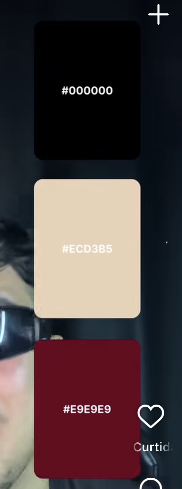

# Paleta: Preto · Areia · Vinho

| # | Nome   | HEX       | RGB              | Uso sugerido                  |
|---|--------|-----------|------------------|-------------------------------|
| 1 | Preto  | `#000000` | 0, 0, 0          | Fundo / texto principal       |
| 2 | Areia  | `#ECD3B5` | 236, 211, 181    | Fundo claro / superfícies     |
| 3 | Vinho  | `#600F1E` | 96, 15, 30       | Destaque / acento             |

> **Atenção:** na imagem original o terceiro bloco está rotulado como `#E9E9E9`
> (um cinza-claro), mas a cor exibida é um vinho escuro. O valor `#600F1E` foi
> amostrado diretamente dos pixels da imagem. Se quiser o cinza do rótulo, use
> `#E9E9E9` (variável `--cinza-rotulo`).
